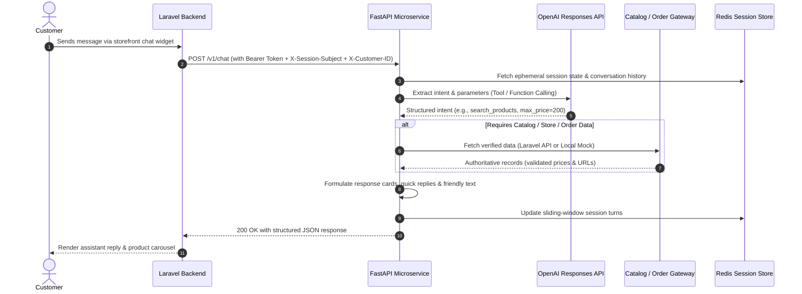

# 🛍️ Loulou AI — Shopping Assistant Microservice

<p align="center">
  
  
  
  
  
  
  
</p>

A production-ready, session-scoped **bilingual (Arabic & English)** conversational commerce microservice. Built with **FastAPI** and **Python 3.12**, it is designed to operate securely behind a **Laravel** multi-store e-commerce application.

---

## 🌟 Key Features

* **🌐 Native Bilingual Support (Arabic & English)**: Understands Egyptian/Gulf Arabic dialects and English, intelligently switching languages based on customer input.
* **🛡️ Zero Hallucinations**: Product prices, stock, descriptions, and store information are fetched directly from authoritative backend APIs. The AI is used strictly for intent classification and entity/slot extraction via OpenAI Function Calling.
* **🔒 Enterprise Order Tracking Security**:
  * Never lists or discloses customer orders indiscriminately.
  * Lookups require an explicit order reference typed in the user's message and customer authentication.
  * Cross-customer order probing is strictly blocked (returns 404/not found without revealing order existence).
* **⚡ Dual-Mode Operation**:
  * **Zero-Cost Local Mode**: Instant local development using regex intent planning and a mock catalog—no OpenAI API key or Laravel server required.
  * **Production Mode**: Full integration with OpenAI Responses API and Laravel backend APIs.
* **🔄 Seamless Escalation**: Generates pre-formatted WhatsApp customer service deep-links when user requests human assistance or when queries exceed platform policies.
* **🗄️ Secure Session Management**: Ephemeral conversation sessions backed by an in-memory store (development) or a distributed Redis cluster with automated sliding TTL eviction.
* **🚀 Production-Grade Quality**: Includes 52 automated tests, rate limiting, token-bucket protection, Docker containerization, and structured telemetry.

---

## 🏛️ System Architecture

The AI microservice lives in a private network behind your primary Laravel backend. The frontend client never communicates with FastAPI directly and never holds the `AI_SERVICE_TOKEN`.



---

## ⚙️ Operational Modes

Switch modes instantly by updating `.env`:

| Mode | `PLANNER_MODE` | `BACKEND_MODE` | Description |
|---|---|---|---|
| **Local Demo** | `demo` | `mock` | **100% Free & Offline.** Uses rule-based planning and local JSON catalog fixture. |
| **AI Evaluation** | `openai` | `mock` | Evaluates real OpenAI function calling against local mock catalog. Requires `OPENAI_API_KEY`. |
| **Production** | `openai` | `laravel` | Full live integration with OpenAI and live Laravel backend endpoints. |

---

## 🚀 Quick Start Guide

### Prerequisites
* Python 3.12 or higher
* Git

### Local Setup (PowerShell / Windows)

```powershell
# 1. Clone repository
git clone https://github.com/Zeyadmohamed291/ChatBot.git
cd ChatBot

# 2. Create and activate virtual environment
python -m venv .venv
.\.venv\Scripts\Activate.ps1

# 3. Install locked dependencies
pip install -r requirements-dev.lock
pip install --no-deps -e .

# 4. Create environment file
Copy-Item .env.example .env

# 5. Start the FastAPI development server
python -m uvicorn app.main:create_app --factory --host 127.0.0.1 --port 8000
```

### Local Setup (macOS / Linux)

```bash
python3 -m venv .venv
source .venv/bin/activate
pip install -r requirements-dev.lock
pip install --no-deps -e .
cp .env.example .env
python3 -m uvicorn app.main:create_app --factory --host 127.0.0.1 --port 8000
```

* **Interactive Swagger UI**: Visit `http://127.0.0.1:8000/docs` in your browser.
* **Interactive CLI Chat**: Open another terminal and run:
  ```powershell
  python scripts/chat.py
  ```
* **Automated Scripted Demo**:
  ```powershell
  python scripts/demo.py
  ```

---

## 🔧 Environment Configuration

All settings are configured in `.env` (see [`.env.example`](.env.example)):

| Variable | Default | Purpose |
|---|---|---|
| `ENVIRONMENT` | `development` | Set to `production` in staging/production deployments. |
| `PLANNER_MODE` | `demo` | `demo` (rule-based) or `openai` (GPT model). |
| `BACKEND_MODE` | `mock` | `mock` (local JSON fixture) or `laravel` (live HTTP API). |
| `AI_SERVICE_TOKEN` | *required* | Secret Bearer token shared between Laravel and FastAPI. |
| `OPENAI_API_KEY` | *optional* | OpenAI API secret key (required if `PLANNER_MODE=openai`). |
| `OPENAI_MODEL` | `gpt-4o-mini` | OpenAI model identifier supporting structured function calling. |
| `BACKEND_BASE_URL` | *empty* | Base HTTPS URL of Laravel backend (e.g. `https://shop.example`). |
| `BACKEND_API_TOKEN` | *empty* | Read-only bearer token for querying Laravel catalog endpoints. |
| `ALLOWED_CATALOG_HOSTS` | `["demo.example"]` | Whitelist of allowed product domains (prevents phishing & SSRF). |
| `ALLOWED_TRACKING_HOSTS`| `["tracking.example"]`| Whitelist of allowed shipping carrier domains. |
| `WHATSAPP_PHONE` | *empty* | Support WhatsApp number (digits only, e.g. `966500000000`). |
| `REDIS_URL` | *empty* | Redis connection string (e.g. `redis://localhost:6379/0`). |
| `SESSION_TTL_SECONDS` | `1800` | Sliding session expiration (30 minutes of inactivity). |

---

## 📡 API Contract Overview

For full schema definitions and edge-case handling, refer to [`docs/API_CONTRACT.md`](docs/API_CONTRACT.md).

### Main Endpoints

* `POST /v1/chat`: Main conversational endpoint.
  ```json
  // Request
  {
    "message": "عايز عطر نسائي تحت 200 ريال",
    "session_id": null,
    "locale": "ar",
    "current_store_id": null
  }
  ```
* `DELETE /v1/sessions/{session_id}`: Purges session history upon logout or chat closure.
* `GET /health/live`: Container liveness check.
* `GET /health/ready`: Readiness check verifying session store and gateway availability.

---

## 🐘 Laravel Integration Example

A complete reference controller is provided in [`examples/LaravelAiController.php`](examples/LaravelAiController.php).

```php
// In Laravel Controller:
$response = Http::withToken(config('services.loulou_ai.token'))
    ->withHeaders([
        'X-Session-Subject' => $request->session()->get('ai_subject'),
        'X-Customer-ID'     => $request->user()?->id,
    ])
    ->post(config('services.loulou_ai.url') . '/v1/chat', [
        'message'          => $request->input('message'),
        'session_id'       => $request->session()->get('ai_session_id'),
        'locale'           => app()->getLocale(),
    ]);

if ($response->successful()) {
    $request->session()->put('ai_session_id', $response->json('session_id'));
    return response()->json($response->json());
}
```

---

## 🧪 Testing & Quality Assurance

The codebase includes comprehensive test suites running completely offline in **under 3 seconds**:

```powershell
# 1. Run all 52 unit and integration tests
python -m pytest -q -p no:cacheprovider

# 2. Run code style & static analysis
python -m ruff check app tests scripts

# 3. Run automated end-to-end smoke test
python scripts/smoke.py

# 4. Run model evaluation benchmark (requires OPENAI_API_KEY)
python scripts/evaluate.py --live
```

---

## 🐳 Docker & Production Deployment

Run the complete stack with Redis in Docker:

```bash
# Build and run with Docker Compose
docker compose up -d

# Check service health
curl -f http://127.0.0.1:8000/health/ready
```

---

## 📁 Repository Directory Structure

```text
├── .github/workflows/       # GitHub Actions CI pipeline
├── app/                     # Core application package
│   ├── data/catalog.json    # Local development & test catalog fixture
│   ├── config.py            # Strongly typed settings & environment validation
│   ├── errors.py            # Domain-specific HTTP exceptions
│   ├── gateway.py           # Catalog & order gateway (Mock / Laravel)
│   ├── main.py              # FastAPI app, lifespan, auth & rate limits
│   ├── models.py            # Pydantic schemas (Request/Response/Cards)
│   ├── planner.py           # Intent planner (OpenAI Function Calling / Demo)
│   ├── replies.py           # Bilingual response templates & WhatsApp links
│   ├── service.py           # Dialog orchestrator & security guard
│   ├── sessions.py          # Session store (In-Memory / Redis)
│   ├── telemetry.py         # Structured logging & metrics
│   └── text.py              # Arabic normalization & language detection
├── docs/                    # Complete technical documentation
│   ├── ACCEPTANCE.md        # Quality verification & test scenarios
│   ├── API_CONTRACT.md      # API contract for Laravel & frontend teams
│   ├── ARCHITECTURE_PLAN.md # System architecture & roadmap
│   ├── CODE_GUIDE.md        # Technical developer code guide
│   ├── WALKTHROUGH.md       # Architectural system walkthrough
│   ├── openapi.json         # Auto-generated OpenAPI 3.1 specification
│   ├── ar/                  # Arabic documentation archive
│   └── spec/                # SRS & business requirement specifications
├── examples/                # Laravel integration reference controller
├── scripts/                 # CLI tools (interactive chat, smoke test, evaluator)
├── tests/                   # 52 automated unit & integration test cases
├── compose.yaml             # Docker Compose stack with Redis
├── Dockerfile               # Production multi-stage Docker build
├── pyproject.toml           # Project packaging & tool configuration
├── requirements.lock        # Production pinned dependencies
└── requirements-dev.lock    # Development pinned dependencies
```

---

## 📚 Documentation Index

* 🇬🇧 **[System Walkthrough](docs/WALKTHROUGH.md)** — Architectural overview and sequence diagrams.
* 🇬🇧 **[API Integration Contract](docs/API_CONTRACT.md)** — Detailed JSON specifications for Laravel & Frontend.
* 🇬🇧 **[Acceptance & Quality Criteria](docs/ACCEPTANCE.md)** — Evaluation criteria, security checks, and QA scenarios.
* 🇬🇧 **[Code Guide](docs/CODE_GUIDE.md)** — File-by-file developer reference.
* 🇬🇧 **[Architecture Plan](docs/ARCHITECTURE_PLAN.md)** — Design decisions, scope, and phases.
* 🇸🇦 **[Arabic Documentation Archive](docs/ar/)** — الدليل العربي الكامل ومخطط المشروع.

---

## 📄 License & Ownership

Developed for **Loulou Al Afrah** multi-store platform. All rights reserved.
