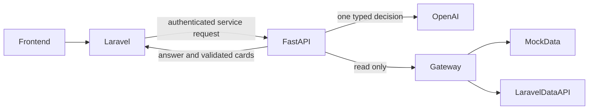

# Loulou AI

خدمة Python/FastAPI مستقلة لمساعد التسوق، جاهزة للتطوير بالتوازي مع Laravel.

لشرح وظيفة كل ملف ومسار المحادثة وأماكن التعديل: [دليل ملفات المشروع بالعربي](docs/CODE_GUIDE_AR.md).

تفهم العربية والإنجليزية عبر OpenAI، وتبحث في كل المتاجر، وتجيب من بيانات الـbackend. الترشيح يعتمد على كلام العميل داخل الجلسة. تتبع الطلب يحتاج رقمًا كتبه العميل في رسالته، وتسجيل الدخول، والتحقق من ملكية الطلب. لا توجد أدوات شراء أو دفع أو إلغاء.

## التشغيل المحلي

Python 3.12 أو أحدث. على Windows/PowerShell:

```powershell
python -m venv .venv
.\.venv\Scripts\python.exe -m pip install -r requirements-dev.lock
.\.venv\Scripts\python.exe -m pip install --no-deps -e .
Copy-Item .env.example .env
.\.venv\Scripts\python.exe -m uvicorn app.main:create_app --factory --host 127.0.0.1 --port 8000
```

إن كان ملف `.env` موجودًا بالفعل فلا تستبدله. التثبيت المحلي الحالي يحتوي بالفعل بيئة `.venv` وملف إعدادات بمفتاح خدمة عشوائي؛ ابدأ بأمر التشغيل فقط.

توثيق الـAPI التفاعلي في وضع التطوير: `http://127.0.0.1:8000/docs`.

لتجربة محادثة كاملة على الخدمة التي تعمل محليًا، من نافذة أخرى:

```powershell
.\.venv\Scripts\python.exe scripts/demo.py
```

السكربت يقرأ مفتاح الخدمة من `.env` من غير طباعته، ويجرب التحية والترشيح وتتبع الطلب، ثم ينهي الجلسة.

## أوضاع التشغيل

| الإعداد | الوظيفة |
|---|---|
| `PLANNER_MODE=demo`, `BACKEND_MODE=mock` | تجربة مجانية محلية بقاعدة كلمات بسيطة وبيانات مصطنعة؛ ليست اختبارًا لجودة نموذج AI |
| `PLANNER_MODE=openai`, `BACKEND_MODE=mock` | اختبار AI حقيقي على بيانات تجريبية؛ يحتاج `OPENAI_API_KEY` و`OPENAI_MODEL` |
| `PLANNER_MODE=openai`, `BACKEND_MODE=laravel` | ربط حقيقي بعد ضبط عنوان الـbackend ومساراته ومفتاح الخدمة |

`OPENAI_MODEL` متروك لاختيار نموذج متاح في حسابكم يدعم Responses API وFunction Calling؛ لم نختبر نموذجًا مدفوعًا من غير مفتاحكم. بيانات المنتجات والمتاجر في وضع mock تحمل أسماء تجريبية وروابط `demo.example` غير مخصصة للتسوق. طلب الاختبار `DEMO-1001` يخص `demo-customer` فقط. لا تستخدم بيانات التجربة في الإطلاق.

## مكان وضع endpoints Laravel لاحقًا

تُضبط القيم التالية في `.env`:

```dotenv
BACKEND_MODE=laravel
BACKEND_BASE_URL=https://your-backend.example
BACKEND_API_TOKEN=your-private-laravel-read-token
BACKEND_STORES_PATH=/api/ai/stores
BACKEND_PRODUCTS_PATH=/api/ai/products/search
BACKEND_FAQ_PATH=/api/ai/faqs/search
BACKEND_ORDER_PATH=/api/ai/orders/{order_number}
ALLOWED_CATALOG_HOSTS=["your-shop.example","your-cdn.example"]
ALLOWED_TRACKING_HOSTS=["your-shipping-provider.example"]
```

العنوان والمسارات والمفاتيح في الإعدادات. إذا اختلف **شكل الرد** من Laravel عن العقد المقترح، يتم التعديل في `app/gateway.py` فقط. هذا أهم من مجرد تبديل الروابط: يجب مطابقة الحقول، أنواع القيم، حالات الطلب، والتحقق من الصلاحيات. التفاصيل في [عقد الربط](docs/API_CONTRACT.md).

## التصميم



النموذج يختار عملية واحدة محددة بمعاملات مقيدة عبر Function Calling. الكود ينفذ القراءة ويكوّن الرد من البيانات الموثوقة. الأسعار والسياسات وحالة الطلب لا تُولد بحرية من النموذج. بطاقات المنتجات تحتوي على الوصف والسعر الحقيقيين. هذا التصميم يحتاج عادة استدعاء نموذج واحد للرسالة ويجعل فحص رقم الطلب والصلاحيات مستقلًا عن تعليمات النموذج.

تجري محادثة النموذج باستدعاءات مستقلة مع سياق محدود من الجلسة و`store=false`؛ مخرجات حالة الطلب لا تُرسل كجزء من سياق لاحق. `store=false` لا يعني تغيير سياسة الاحتفاظ لدى مزوّد الخدمة؛ راجع إعدادات مشروع OpenAI عند الإطلاق.

| الملف | المسؤولية |
|---|---|
| `app/main.py` | نقاط HTTP، مصادقة خدمة Laravel، حدود الطلبات، دورة حياة الموارد |
| `app/service.py` | قواعد الحوار والقراءة والترشيح ورقم الطلب |
| `app/planner.py` | مخطط OpenAI الفعلي ووضع العرض المحلي |
| `app/gateway.py` | عقد القراءة وتنفيذ mock وLaravel |
| `app/models.py` | نماذج الإدخال والبيانات والإخراج |
| `app/replies.py` | ردود ودودة باللغتين وتسميات الحالات وواتساب |
| `app/sessions.py` | جلسات مؤقتة، عزل المستخدمين ومنع تداخل الرسائل |
| `app/data/catalog.json` | بيانات مصطنعة، وليست بيانات المشروع الفعلية |
| `examples/LaravelAiController.php` | مثال الربط من Laravel، يحتاج مواءمة مع المشروع الفعلي |

## الجلسات والصلاحيات

- الخدمة تستقبل الاتصالات من Laravel. مفتاح `AI_SERVICE_TOKEN` لا يوضع في المتصفح.
- Laravel يولّد `X-Session-Subject` من جلسته، ويستخرج `X-Customer-ID` من المستخدم المسجل. لا يمرر قيم هذين الرأسين من العميل.
- الجلسة مربوطة بهوية جلسة Laravel وهوية المستخدم معًا. تغيير الحساب أو الدخول يتطلب جلسة AI جديدة. بعد الدخول يُعاد إرسال رقم الطلب في رسالة المستخدم.
- `DELETE /v1/sessions/{id}` يمسح المحادثة. يجب استدعاؤه عند إنهاء الجلسة أو قبل تسجيل الخروج. تغيير الصفحة داخل الموقع لا ينهي الجلسة.
- TTL افتراضي 30 دقيقة خمول يمسح الجلسات المهجورة. الـfrontend يجب ألا يحفظ التاريخ أو معرف الجلسة في تخزين دائم. إغلاق المتصفح لا يضمن وصول طلب حذف، ولذلك توجد مدة انتهاء تلقائية.
- وضع الذاكرة المحلية مناسب لعملية واحدة في التطوير. وضع الإنتاج يحتاج Redis مشتركًا مع تعطيل حفظه على القرص والنسخ الاحتياطية لهذه الجلسات.
- سجل التشغيل يحتوي request id، زمن التنفيذ، العملية، وعدد tokens. لا نكتب نص الرسائل أو تفاصيل الطلب في السجلات.

## ما يعرضه فريق الواجهة

نص `answer`، بطاقات `product_cards` و`store_cards`، حقل `order` عند نجاح التحقق، و`quick_replies` عند البداية. يعرض `requires_order_number` أو `requires_login` المسار المطلوب. زر واتساب يظهر فقط عند `handoff.requested=true` ووجود `handoff.url`. يُرسم النص كنص عادي وليس HTML. روابط الصور والمنتجات تتقيد بالدومينات في الإعدادات.

دور الواجهة يشمل الزر العائم في الصفحات، دعم RTL/LTR، مؤشر الانتظار، ومنع الرسائل الفارغة أو أكثر من 300 حرف. الخدمة تتحقق من حدود الإدخال أيضًا. الـAPI الحالي يعيد JSON مكتملًا؛ لم نضف تدفقًا شكليًا للنص يوحي بسرعة لم تُقَس. زمن OpenAI وLaravel الحقيقيان يجب قياسهما قبل اعتماد شرط الثانيتين.

## الاختبارات

```powershell
.\.venv\Scripts\python.exe -m pytest -q -p no:cacheprovider
.\.venv\Scripts\python.exe -m ruff check app tests scripts
.\.venv\Scripts\python.exe scripts/smoke.py
```

الاختبارات تعمل بلا شبكة خارجية وتستخدم SDK OpenAI الحقيقي مع HTTP transport تجريبي، وLaravel responses تجريبية، وRedis محاكى. تشمل: ملكية الطلب، عدم استدعاء الطلبات بدون رقم/دخول، رفض رقم مخترع من النموذج، عزل الجلسات وانتهاؤها وحذفها والتداخل، الردود غير المطابقة للعقد، أخطاء التكامل، اللغتين، الميزانيات، الروابط، حدود الحجم/التكرار، وغياب عمليات الدفع والإلغاء.

سيناريوهات التقييم مع النموذج الحقيقي موجودة في `docs/ACCEPTANCE.md`. نجاح الاختبارات المحلية لا يغني عن اختبار النموذج المختار وعقد Laravel الحقيقي.

بعد ضبط مفتاح OpenAI والموديل، يمكن تشغيل `python scripts/evaluate.py --live` داخل البيئة المعزولة. هذا الاختبار ينفذ 16 استدعاءً مدفوعًا على نصوص مصطنعة، ويقيس اختيار العمليات واللغة والميزانية وزمن المخطط واستهلاك tokens. لم يُشغّل على حسابكم.

## تشغيل الإنتاج

ملف Docker موجود. شغّل Redis في شبكة خاصة بدون persistence، واضبط `REDIS_URL` و`ENVIRONMENT=production` ومفاتيح عشوائية، وعنوان Laravel بـHTTPS. وضع الإنتاج يرفض mock وdemo والمفاتيح الناقصة.

الخدمة يجب أن تكون داخل الشبكة الخاصة خلف Laravel، مع TLS وحدود أحجام/مهل اتصال في reverse proxy. `/health/live` يتحقق من حياة العملية؛ `/health/ready` يتحقق من مخزن الجلسات، ولا يعني أن OpenAI أو Laravel تم اختباره لحظيًا. لا حاجة لـCORS عام لأن المتصفح يتصل بـLaravel.

مراجع التصميم: [Function Calling](https://developers.openai.com/api/docs/guides/function-calling)، [Production best practices](https://developers.openai.com/api/docs/guides/production-best-practices).
