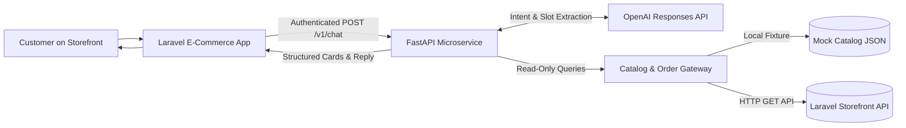

# 📐 Architecture & Implementation Plan — Loulou AI

**Status:** Implementation complete; verified locally with mock fixtures and automated test suites. Ready for staging integration with Laravel and OpenAI API credentials.  
**Specification Reference:** [`docs/spec/Loulou_Al_Afrah_SRS.pdf`](spec/Loulou_Al_Afrah_SRS.pdf) (Requirements FR-BOT-01 through FR-BOT-09, UC-C-09, and BR-11).

---

## 1. System Vision & Scope

The primary objective is to deliver an enterprise-grade, high-performance **bilingual AI shopping assistant** for multi-store e-commerce. The assistant understands customer inquiries from live conversation context, responds concisely in the customer's language (Arabic or English), provides policy FAQs, recommends verified products and stores from the platform catalog, and reports real-time order statuses with customer ownership verification.

### Core Design Principles:
* **Deterministic Information Grounding**: Product prices, stock, descriptions, and order statuses originate exclusively from authoritative backend sources. The language model acts as an intent planner and slot extractor via function calling—never as an unconstrained generative database.
* **Security & Multi-Tenant Isolation**: Orders require explicit order numbers provided by the customer while authenticated. Sessions are strictly bound to Laravel session subjects and customer IDs, with automatic sliding TTL eviction.
* **Zero Customer Lock-in**: If the assistant cannot confidently resolve an issue, or if the customer requests human escalation, it provides direct WhatsApp support handoff.
* **Separation of Concerns**: Laravel remains the system of record for database mutations, checkout, payment, and authentication. The Python microservice is stateless, private, and read-only.

---

## 2. High-Level Architecture

---

## 3. Implementation Phases & Milestones

### Phase 1 — Foundations & Contract Specification (Complete)
- [x] Defined unambiguous JSON API contract between Laravel and FastAPI ([`docs/API_CONTRACT.md`](API_CONTRACT.md)).
- [x] Structured development fixture with multi-store products, categories, and FAQs ([`app/data/catalog.json`](../app/data/catalog.json)).
- [x] Implemented Pydantic data models for requests, responses, and UI cards ([`app/models.py`](../app/models.py)).

### Phase 2 — Core Engine & Intent Planning (Complete)
- [x] Built FastAPI application lifecycle with service token authentication and rate limiting ([`app/main.py`](../app/main.py)).
- [x] Implemented OpenAI Function Calling intent planner with fallback demo mode ([`app/planner.py`](../app/planner.py)).
- [x] Implemented Arabic text normalization, language detection, and input sanitization ([`app/text.py`](../app/text.py)).
- [x] Implemented bilingual response templates and WhatsApp handoff deep-links ([`app/replies.py`](../app/replies.py)).

### Phase 3 — Session Management & Security Isolation (Complete)
- [x] Ephemeral session store with sliding-window history retention ([`app/sessions.py`](../app/sessions.py)).
- [x] Thread-safe in-memory store for local testing and distributed Redis store for production clustering.
- [x] Strict session binding to `X-Session-Subject` and `X-Customer-ID` to prevent cross-tenant access.

### Phase 4 — Data Gateway & Backend Integration (Complete)
- [x] Pluggable catalog gateway supporting local mock data and remote Laravel HTTP endpoints ([`app/gateway.py`](../app/gateway.py)).
- [x] Hostname whitelisting for product and tracking URLs to prevent SSRF and phishing links.
- [x] Order lookup guard requiring literal user-typed order numbers and active authentication.

### Phase 5 — Quality Assurance & Tooling (Complete)
- [x] Comprehensive test suite with 52 automated tests covering all edge cases ([`tests/`](../tests/)).
- [x] Interactive terminal chat tool ([`scripts/chat.py`](../scripts/chat.py)).
- [x] Automated smoke test ([`scripts/smoke.py`](../scripts/smoke.py)) and benchmark evaluator ([`scripts/evaluate.py`](../scripts/evaluate.py)).
- [x] Production Dockerfile and Compose stack ([`Dockerfile`](../Dockerfile), [`compose.yaml`](../compose.yaml)).

### Phase 6 — Production Rollout & Hand-off (Next Steps)
- [ ] Deploy Laravel read endpoints according to the API contract.
- [ ] Configure production `.env` with OpenAI API key and Redis instance.
- [ ] Perform live end-to-end evaluation with `python scripts/evaluate.py --live`.
