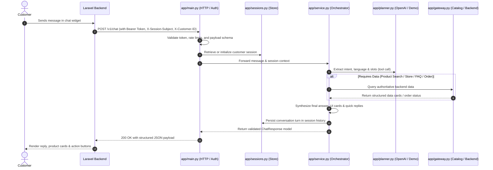

# 🚀 Loulou AI Microservice — Architecture & System Walkthrough

Welcome! This walkthrough provides an end-to-end guide to the **Loulou AI** shopping assistant microservice, explaining its architectural design, request lifecycles, and directory structure.

---

## 📌 1. Overview & System Purpose

**Loulou AI** is a standalone, production-ready microservice built with **Python 3.12** and **FastAPI**.
It functions as a **session-scoped bilingual (Arabic & English) conversational commerce assistant** designed to run behind a Laravel multi-store e-commerce application.

### Key Architectural Tenets:
1. **Decoupled Architecture**: The frontend communicates solely with Laravel. Laravel proxies chat requests to this FastAPI service with authenticated service tokens and verified user session headers.
2. **Deterministic Data & Zero Hallucination**: AI is used strictly for intent classification and slot extraction (via OpenAI Function Calling). Actual product prices, availability, stock, and order statuses are fetched directly from authoritative backend data sources.
3. **Strict Order Security**: The AI never accesses user order lists. Order lookups require the customer to explicitly provide an order number in their message while authenticated; the backend verifies customer ownership before returning status.
4. **Resilient Dual-Mode Operation**: The system operates with zero external dependencies in local mock/demo mode for development and testing, or in full production mode integrated with OpenAI and Laravel.

---

## 🗺️ 2. Request Lifecycle & Sequence Flow

The following diagram illustrates the complete journey of a customer message:



---

## 📂 3. Directory & File Tour

### A. Core Application Package (`app/`)

| File | Description & Responsibility |
|---|---|
| `app/main.py` | **HTTP Entrypoint & Lifecycle**: Sets up FastAPI, configures rate limiting, authenticates service tokens, manages lifespan events, and exposes `/v1/chat`, `/v1/sessions/{id}`, `/health/live`, and `/health/ready`. |
| `app/service.py` | **Core Orchestrator**: Coordinates session state, intent planning, backend data fetching, order security checks, response synthesis, and conversation history updates. |
| `app/planner.py` | **Intent Planner**: Translates user messages into structured actions using OpenAI Function Calling (or deterministic rule-based matching in demo mode). Formulates search parameters, price filters, and extracts order numbers. |
| `app/gateway.py` | **Data Gateway**: Abstraction layer for reading store catalog and order data. Implements `MockGateway` (local JSON fixture) and `LaravelGateway` (authenticated HTTP requests to Laravel). |
| `app/sessions.py` | **Session Manager**: Manages ephemeral conversation sessions with sliding TTL expiration. Implements thread-safe `InMemorySessionStore` and distributed `RedisSessionStore`. |
| `app/models.py` | **Pydantic Data Models**: Defines strict schemas for chat requests/responses, product cards, store cards, order statuses, handoff objects, and planner intents. |
| `app/config.py` | **Configuration**: Reads and validates environment variables using `pydantic-settings`. |
| `app/replies.py` | **Localized Templates**: Standard Arabic and English message templates, status badges, and WhatsApp handoff deep-links. |
| `app/text.py` | **Text & Language Utilities**: Normalizes Arabic diacritics/alphabets, detects language, sanitizes inputs, and formats numbers. |
| `app/errors.py` | **Custom Exceptions**: Domain-specific error classes mapped to clear HTTP status codes. |
| `app/telemetry.py` | **Logging & Observability**: Structured request logging, timing instrumentation, and token usage metrics without logging sensitive customer messages. |
| `app/data/catalog.json` | **Development Fixture**: Mock multi-store catalog, products, and FAQs used for zero-dependency local development and automated testing. |

---

### B. Documentation (`docs/`)

* **`docs/WALKTHROUGH.md`**: This architectural guide.
* **`docs/API_CONTRACT.md`**: Complete API contract between Laravel, AI microservice, and frontend.
* **`docs/ACCEPTANCE.md`**: Quality criteria, security verification scenarios, and acceptance checklist.
* **`docs/CODE_GUIDE.md`**: Deep-dive technical code guide for developers.
* **`docs/openapi.json`**: Auto-generated OpenAPI 3.1 specification for Postman / Swagger.
* **`docs/spec/`**: Specification documents and reference PDFs.
* **`docs/ar/`**: Complete Arabic documentation archive (`CODE_GUIDE.md`, `WALKTHROUGH.md`, `AI_PLAN.md`).

---

### C. Test Suite (`tests/`)

52 automated unit and integration tests executing in under 3 seconds without external network dependencies:

* **`tests/conftest.py`**: Test fixtures, mock environments, and fake Redis setup.
* **`tests/test_chat.py`**: Chat flows, multi-store filtering, price constraints, bilingual switching, and quick replies.
* **`tests/test_sessions.py`**: Session isolation, expiry, deletion, subject binding, and concurrent access.
* **`tests/test_integrations.py`**: Gateway verification, contract adherence, and Redis persistence simulation.
* **`tests/test_failures.py`**: Fault tolerance, backend outages, rate limiting, and malicious input handling.

---

### D. Utility Scripts (`scripts/`)

* **`scripts/chat.py`**: Interactive terminal chat for live testing with rich formatting.
* **`scripts/demo.py`**: Non-interactive scripted walkthrough exercising greetings, product search, and order tracking.
* **`scripts/smoke.py`**: Automated smoke test that boots a temporary server on an ephemeral port and tests end-to-end functionality.
* **`scripts/evaluate.py`**: Benchmark runner evaluating planner accuracy, latency, and token consumption.
* **`scripts/export_openapi.py`**: Exports the current OpenAPI schema to `docs/openapi.json`.
* **`scripts/lock_dependencies.py`**: Locks pinned dependency versions.

---

### E. Integration Examples (`examples/`)

* **`examples/LaravelAiController.php`**: Reference Laravel controller demonstrating session subject generation, token propagation, customer ID forwarding, and chat proxying.

---

## ⚙️ 4. Operational Modes

The service behavior is controlled via environment variables:

| Mode | Configuration | Use Case |
|---|---|---|
| **Local Demo (Zero Cost)** | `PLANNER_MODE=demo`<br>`BACKEND_MODE=mock` | Instant local development and testing without OpenAI keys or Laravel backend. |
| **AI Evaluation with Mock Catalog** | `PLANNER_MODE=openai`<br>`BACKEND_MODE=mock` | Evaluate real OpenAI intelligence and function calling against local mock catalog. |
| **Full Production Integration** | `PLANNER_MODE=openai`<br>`BACKEND_MODE=laravel` | Live production mode connecting OpenAI with the real Laravel e-commerce API. |

---

## 🚀 5. Quick Commands Reference

```powershell
# 1. Start development server
.\.venv\Scripts\python.exe -m uvicorn app.main:create_app --factory --host 127.0.0.1 --port 8000

# 2. Run interactive chat
.\.venv\Scripts\python.exe scripts/chat.py

# 3. Execute test suite
.\.venv\Scripts\pytest -q

# 4. Run linter
.\.venv\Scripts\ruff check app tests scripts
```
