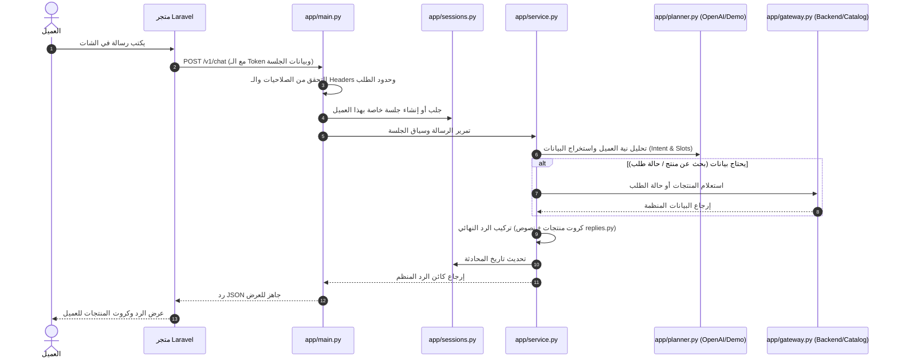

# 🚀 الدليل الشامل لمشروع Loulou AI (Project Walkthrough)

مرحباً بك! هذا الدليل مُصمم ليكون مرجعاً سهلاً ومرتباً لقراءة وفهم مشروع **Loulou AI** بالكامل، حيث يشرح المعمارية العامة، ومسار البيانات، ووظيفة كل ملف في المشروع.

---

## 📌 1. نظرة عامة والهدف من المشروع

مشروع **Loulou AI** هو **Microservice مستقلة** مبنية باستخدام **Python و FastAPI**.
هدفها الأساسي هو العمل كـ **مساعد تسوق ذكي ثنائي اللغة (عربي / إنجليزي)** لمتجر إلكتروني.

> **ملاحظة:**
> المتجر الرئيسي (واجهة المستخدم ولوحة التحكم) مصمم ليكون مبنياً بـ **Laravel (PHP)**. المتجر يستقبل العميل، ثم يرسل رسالته إلى خدمة Python هذه عبر API داخلي للحصول على الترشيحات والإجابات الذكية وتتبع الطلبات.

---

## 🗺️ 2. مخطط تدفق الرسالة (Request Lifecycle)

يوضح المخطط التالي كيف تسير الرسالة من لحظة كتابة العميل وحتى استلام الرد:



---

## 📂 3. جولة تفصيلية داخل مجلدات وملفات المشروع

### أ) الكود البرمجي الأساسي: `app/`

| الملف | الوظيفة والدور البرمجي |
|---|---|
| `app/main.py` | **نقطة الدخول (Entry Point):** يبدأ سيرفر FastAPI، ويوفر مسارات `/v1/chat` و `/health/ready`، ويدير التحقق من الأمان (Security Headers & Tokens)، ومعدل الاستخدام (Rate Limiting). |
| `app/service.py` | **المنسق العام (Orchestrator):** العصب المركزي للمشروع؛ يربط الجلسة مع الـ Planner والـ Gateway ويصوغ الرد النهائي ويضمن سلامة البيانات. |
| `app/planner.py` | **مخطط النوايا (Intent Planner):** عقل الذكاء الاصطناعي؛ يفهم كلام العميل ويصنفه (تحية، استفسار، بحث، تتبع طلب)، ويستخرج المتغيرات (السعر، الصنف، رقم الطلب). يدعم OpenAI أو القواعد التجريبية (Demo). |
| `app/gateway.py` | **بوابة البيانات (Data Gateway):** المسؤولة عن جلب البيانات. تحتوي على `LaravelGateway` (للاتصال بـ Laravel حقيقي) و `MockGateway` (للقراءة من ملف تجريبي). |
| `app/sessions.py` | **مدير الجلسات (Session Manager):** يحفظ سياق الحديث للمستخدم ليتذكر الردود السابقة. يدعم التخزين المؤقت في الذاكرة أو في **Redis** مع توقيت انتهاء (TTL). |
| `app/models.py` | **نماذج البيانات (Pydantic Models):** تعريف هيكل الطلبات والردود وبطاقات المنتجات بدقة، وضمان صحة أنواع البيانات (Type Safety). |
| `app/config.py` | **الإعدادات والبيئة:** قراءة المتغيرات من ملف `.env` (مفاتيح API، منافذ السيرفر، إعدادات Redis) والتحقق منها. |
| `app/replies.py` | **قوالب الردود:** نصوص وقوالب الإجابات الجاهزة باللغتين العربية والإنجليزية لضمان ردود احترافية ومترابطة. |
| `app/text.py` | **معالجة النصوص:** تنظيف النصوص، إزالة التشكيل العربي، كشف لغة الإدخال، وتنظيف الأحرف والمسافات. |
| `app/errors.py` | **الاستثناءات (Custom Exceptions):** تعريف أخطاء التطبيق الخاصة لتسهيل معالجتها وإرجاع أكواد HTTP مناسبة. |
| `app/telemetry.py` | **المراقبة والتتبع:** تسجيل السجلات (Logs)، مقاييس وقت الاستجابة، وتتبع الأحداث داخل التطبيق. |
| `app/data/catalog.json` | **بيانات تجريبية:** كتالوج تجريبي يحتوي على منتجات ومتاجر وأسئلة شائعة لاختبار النظام محلياً دون الحاجة لقاعدة بيانات خارجية. |

---

### ب) مجلد الوثائق: `docs/`

* **`docs/WALKTHROUGH.md`**: هذا الملف (الدليل العملي الشامل والمبسط).
* **`docs/CODE_GUIDE_AR.md`**: المرجع التقني العربي الأكثر تفصيلاً، يشرح كل دالة ومكان التعديل بالتفصيل.
* **`docs/API_CONTRACT.md`**: مواصفات وشكل الـ JSON المتفق عليه بين فريق Laravel وخدمة الذكاء الاصطناعي.
* **`docs/ACCEPTANCE.md`**: معايير القبول وسيناريوهات الاختبار للتأكد من جودة النظام قبل إطلاقه.
* **`docs/openapi.json`**: التوثيق البرمجي لمسارات الـ API بصيغة OpenAPI القياسية.

---

### ج) مجلد الاختبارات: `tests/`

يحتوي على **52 اختبار آلي** تغطي كافة جوانب الخدمة وتعمل محلياً بالكامل دون الحاجة لأي خوادم خارجية:

* **`tests/conftest.py`**: تجهيز بيئة الاختبار والمحاكيات (Mock Settings, Fake Redis).
* **`tests/test_chat.py`**: فحص سيناريوهات المحادثة والترشيحات ودعم العربية والإنجليزية.
* **`tests/test_sessions.py`**: فحص عزل الجلسات وحمايتها وتجديدها وحذفها.
* **`tests/test_integrations.py`**: فحص بوابات البيانات ومطابقة عقد Laravel.
* **`tests/test_failures.py`**: فحص صمود النظام عند حدوث أخطاء شبكة أو إدخال بيانات غير صحيحة.

---

### د) مجلد السكربتات المساعدة: `scripts/`

* **`scripts/demo.py`**: محادثة تفاعلية سريعة من شاشة الأوامر (Terminal) لتجربة الشات فورياً.
* **`scripts/smoke.py`**: فحص فوري سريع (Smoke Test) للتأكد أن السيرفر يعمل ويستجيب بنجاح.
* **`scripts/evaluate.py`**: تقييم سرعة ودقة الـ Planner ونموذج الـ AI عبر حالات محددة.
* **`scripts/export_openapi.py`**: تحديث ملف `openapi.json` من كود FastAPI تلقائياً.
* **`scripts/lock_dependencies.py`**: قفل وتثبيت إصدارات مكتبات بايثون.

---

### هـ) مجلد الأمثلة: `examples/`

* **`examples/LaravelAiController.php`**: كود PHP جاهز يوضح لمطور Laravel كيف يربط تطبيقه بخدمة Python، وكيف يمرر الـ Headers والـ Tokens بطريقة آمنة.

---

### و) ملفات الإعداد والتشغيل في المجلد الرئيسي

* **`.env`**: ملف الإعدادات الحالية لجهازك (مفاتيح الخدمة، المنافذ، وضع التشغيل).
* **`.env.example`**: نموذج استرشادي للمتغيرات البيئية المطلوبة عند النشر في أي سيرفر جديد.
* **`pyproject.toml`**: ملف إعدادات حزمة بايثون وقائمة التبعيات وأدوات التطوير (pytest, ruff).
* **`requirements.lock`**: القفل الدقيق لإصدارات مكتبات التشغيل.
* **`requirements-dev.lock`**: القفل الدقيق لمكتبات التطوير والاختبارات.
* **`Dockerfile` و `compose.yaml`**: لتشغيل الخدمة وسيرفر Redis داخل حاويات Docker بسهولة.

---

## ⚙️ 4. أوضاع التشغيل الأساسية (Operational Modes)

تتحكم المتغيرات في ملف `.env` في كيفية عمل النظام:

| الوضع | الإعدادات في `.env` | الاستخدام |
|---|---|---|
| **تجريبي محلي 100% (مجاني)** | `PLANNER_MODE=demo`<br>`BACKEND_MODE=mock` | يعمل بدون مفتاح OpenAI وبدون سيرفر Laravel (باستخدام البيانات التجريبية). |
| **ذكاء اصطناعي + بيانات تجريبية** | `PLANNER_MODE=openai`<br>`BACKEND_MODE=mock` | يستخدم ذكاء OpenAI الحقيقي لفهم العميل مع كتالوج تجريبي لاختبار جودة الردود. |
| **ربط كامل مع الإنتاج** | `PLANNER_MODE=openai`<br>`BACKEND_MODE=laravel` | الوضع النهائي؛ ذكاء اصطناعي حقيقي + جلب بيانات المنتجات والطلبات من سيرفر Laravel الحقيقي. |

---

## 🛠️ 5. كيف تبدأ وتشغل المشروع عملياً؟

> **ملاحظة للمطور:**
> جميع المكتبات مثبتة لديك بالفعل داخل المجلد `.venv` وجميع الاختبارات ناجحة!

1. **لتشغيل السيرفر المحلي:**
   ```powershell
   .\.venv\Scripts\python.exe -m uvicorn app.main:create_app --factory --host 127.0.0.1 --port 8000
   ```
2. **لفتح واجهة التوثيق التفاعلية (Swagger UI):**
   افتح المتصفح على: `http://127.0.0.1:8000/docs`
3. **لتجربة الشات في نافذة أوامر أخرى:**
   ```powershell
   .\.venv\Scripts\python.exe scripts/demo.py
   ```
4. **لتشغيل الاختبارات في أي وقت والتأكد من سلامة الكود:**
   ```powershell
   .\.venv\Scripts\pytest
   ```
